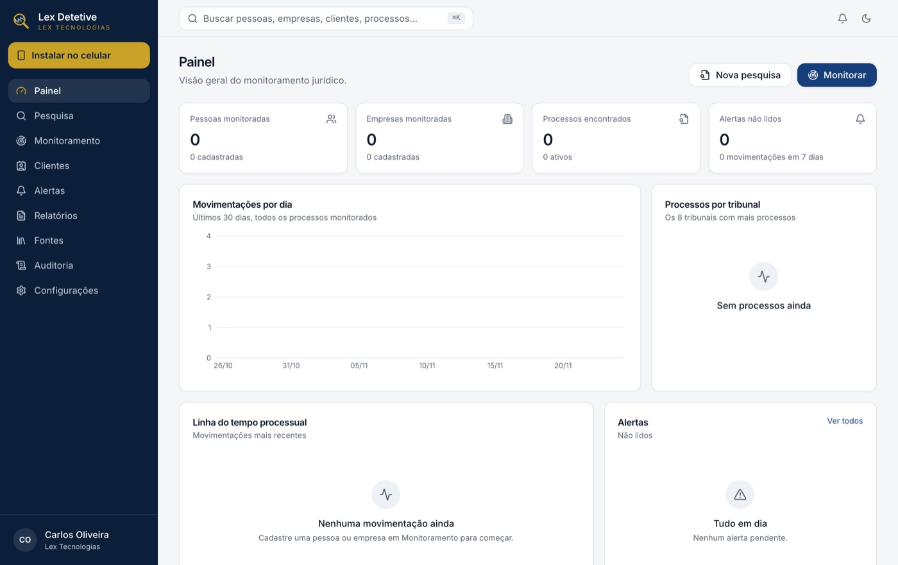
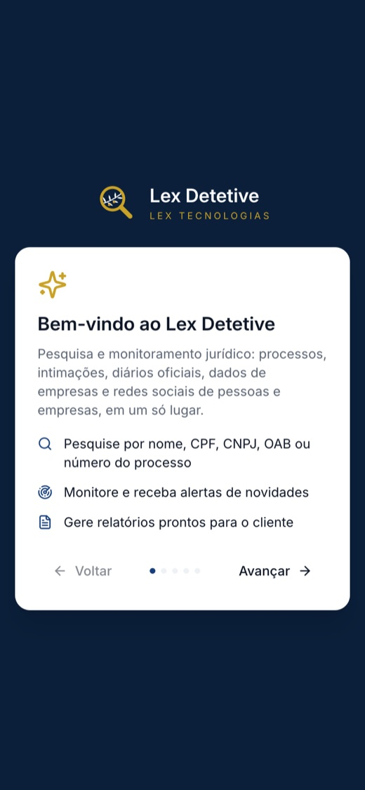
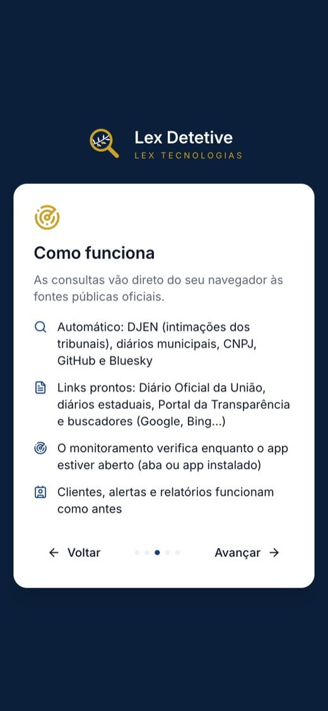
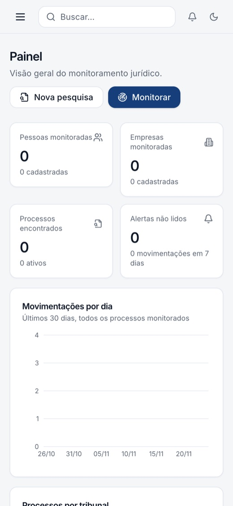
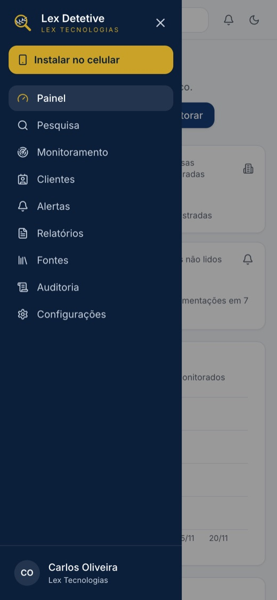
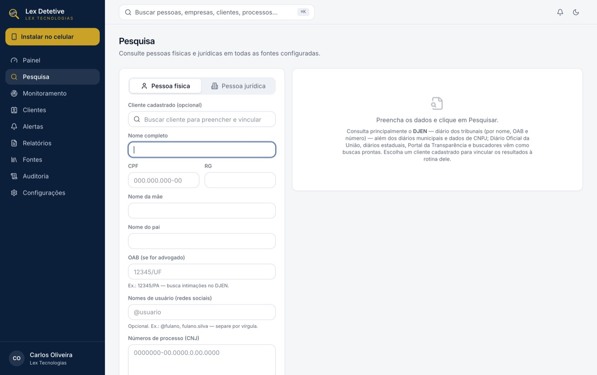
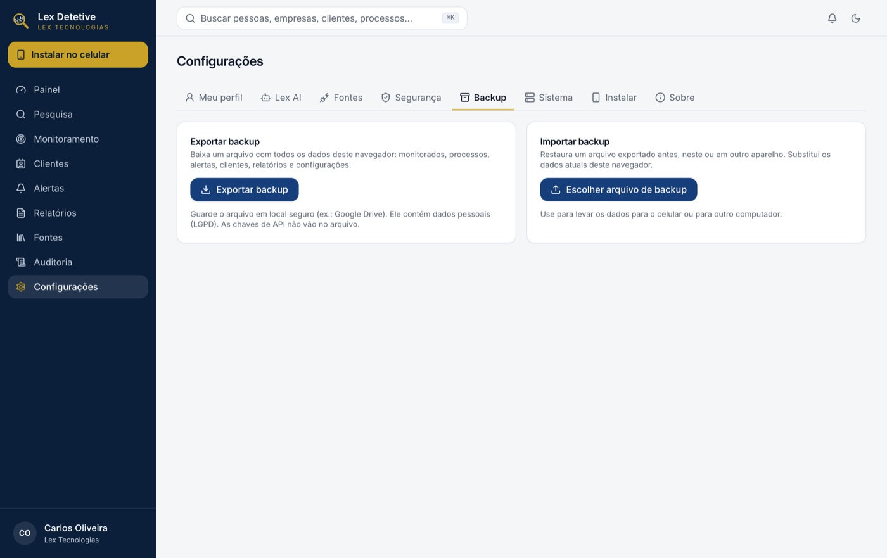
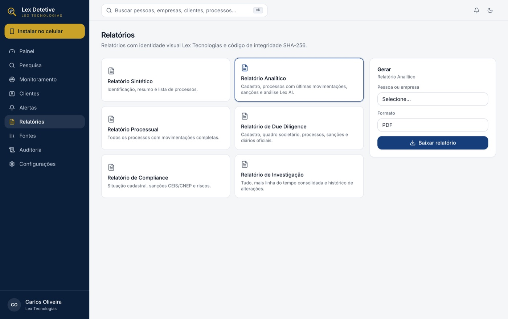

<p align="center"></p>

<h1 align="center">Lex Detetive</h1>

<p align="center"><b>Pesquisa e monitoramento jurídico, direto no seu navegador.</b><br>
Processos, intimações, diários oficiais, dados de empresas e perfis públicos, com alertas e relatórios prontos.<br>
Gratuito · sem cadastro · os dados ficam no seu aparelho.</p>

<p align="center">
  <a href="https://oliveiracarlosadv.github.io/Lex-Detetive/app/"></a>
</p>

<p align="center"><a href="https://oliveiracarlosadv.github.io/Lex-Detetive/">Página de apresentação</a> · <a href="#manual">Manual</a> · <a href="#instalar-no-celular">Instalar no celular</a> · <a href="#sobre">Sobre</a></p>

<p align="center"></p>

---

## O que é

O **Lex Detetive** é um aplicativo web (PWA) da **Lex Tecnologias** para advogados, peritos, investigadores e equipes de compliance. Você abre pelo navegador, como um site, e pode instalá-lo na tela inicial do celular ou do computador.

- **Sem servidor e sem conta:** tudo fica guardado no navegador do seu aparelho (IndexedDB). Nada é enviado à Lex Tecnologias.
- **Fontes públicas oficiais:** as consultas saem do seu navegador direto para elas.
- **Backup com um clique:** exporte e importe todos os dados para levar a outro aparelho.

## Como funciona

| 1. Abra e se apresente | 2. Pesquise | 3. Monitore |
|---|---|---|
| Clique em **USE AQUI**. No primeiro acesso, uma apresentação curta explica o app e pede seu nome (e foto, se quiser). | Nome, CPF, CNPJ, OAB ou número do processo. O app mostra processos, partes, publicações e dados cadastrais. | As novidades viram **alertas**; tudo pode virar **relatório** em PDF, Word ou Excel. |

<p align="center">
  
  
  
  
</p>

## Recursos

- **Processos e intimações** pelo DJEN (Diário de Justiça Eletrônico Nacional, CNJ), fonte principal.
- **Conferência de CPF/CNPJ** nas publicações, com aviso de possíveis homônimos.
- **Alertas** de novos processos, intimações e movimentações recentes, sem repetir publicações antigas; lateral com autores e réus e vínculo ao cliente (Sim/Não).
- **Dados de empresas** (BrasilAPI e CNPJá): situação, sócios, endereço, Simples e MEI; botão **Buscar dados** preenche cadastros pelo CNPJ.
- **Diários oficiais:** municipais automaticamente; União e 27 estados como buscas prontas.
- **Redes sociais e internet:** perfis públicos por nome de usuário; buscas prontas no Google, Bing, DuckDuckGo e Yandex.
- **Clientes** com vínculo de processos e sugestão automática.
- **Relatórios forenses** (sintético, analítico, processual, due diligence, compliance, investigação) em PDF, DOCX, ODT, XLSX, CSV, HTML, TXT e JSON, com resumo de cada processo.
- **Lex AI** (opcional): Gemini, Claude, OpenAI, OpenRouter, Grok ou Ollama local.
- **Privacidade:** CPF/CNPJ mascarados, auditoria e senha de bloqueio opcional.

### Fontes

| Automáticas | Buscas prontas (um clique) |
|---|---|
| DJEN (CNJ), Querido Diário, BrasilAPI, CNPJá, GitHub, Bluesky, Mastodon, GitLab | Diário Oficial da União, diários dos 27 estados, Portal da Transparência, Google, Bing, DuckDuckGo, Yandex, Instagram, Facebook, X, TikTok, LinkedIn, BNMP |

Alguns sites oficiais não permitem consulta automática a partir do navegador; para eles, o app monta a busca e você abre o resultado oficial.

<p align="center"></p>

## Instalar no celular

| iPhone e iPad (Safari) | Android (Chrome) | Computador (Chrome/Edge) |
|---|---|---|
| Toque em **Compartilhar** → **Adicionar à Tela de Início** → **Adicionar**. | Toque no menu **⋮** → **Instalar app** → **Instalar**. | Clique no ícone de instalar no fim da barra de endereço → **Instalar**. |

Dentro do app, o botão **Instalar no celular** do menu mostra as mesmas instruções.

## Manual

<details><summary><b>1. Primeiro acesso</b></summary>

1. Clique em **USE AQUI**.
2. Leia a apresentação (**Avançar**).
3. Informe **nome e sobrenome**; foto e escritório são opcionais.
4. Clique em **Começar a usar**. O menu passa a mostrar seu primeiro e último nome, com a foto.

Se outras pessoas usam o aparelho, ligue a **senha de bloqueio** em Configurações → Segurança.
</details>

<details><summary><b>2. Pesquisa</b></summary>

- Escolha **Pessoa física** ou **Pessoa jurídica** e preencha o que souber (nome, CPF/CNPJ, OAB, redes sociais, números de processo).
- Em pessoa jurídica, digite o CNPJ e clique em **Buscar dados**.
- **Pesquisar** consulta todas as fontes; filtre os processos por **ano** e use **Vincular ao cliente**.
</details>

<details><summary><b>3. Monitoramento</b></summary>

- Depois de pesquisar, clique em **Monitorar** (ou em Monitoramento → **Novo monitoramento**).
- **Consultar agora** atualiza todos os monitorados; **Consultar** na linha atualiza um.
- A verificação automática roda **enquanto o app estiver aberto** (aba ou app instalado).
</details>

<details><summary><b>4. Alertas</b></summary>

- Novos processos, intimações e movimentações recentes, com ficha do processo.
- À direita, os **autores e réus**: clique para filtrar; se já é cliente, **Sim/Não** para vincular; se não, **Cadastrar cliente**.
</details>

<details><summary><b>5. Clientes e relatórios</b></summary>

- Cadastro completo; pelo CNPJ os dados públicos são preenchidos.
- **Monitorar** o cliente vincula a ele todos os processos encontrados.
- Relatórios em seis modelos e oito formatos, com seu nome, registro e logomarca (Configurações → Meu perfil).
</details>

<details><summary><b>6. Backup e troca de aparelho</b></summary>

1. Configurações → Backup → **Exportar backup** (baixa um arquivo `.json`).
2. Guarde o arquivo em local seguro (ele contém dados pessoais).
3. No outro aparelho: Configurações → Backup → **Escolher arquivo de backup**.

Apagar os dados de navegação do site apaga também os dados do app. Faça backups com frequência.
</details>

<p align="center">
  
  
</p>

## Sobre

O Lex Detetive é desenvolvido pela **Lex Tecnologias** a partir das necessidades da rotina jurídica: acompanhar intimações, conferir homônimos, reunir publicações espalhadas em dezenas de diários e entregar ao cliente um relatório claro. A proposta: ferramenta **gratuita, leve e respeitosa com a privacidade**, que funciona em qualquer celular ou computador.

> O Lex Detetive reúne informações públicas para apoiar o trabalho profissional. Resultados por nome podem envolver homônimos; confira sempre nos autos e nas fontes oficiais. Não substitui certidões.

<p align="center">
  <a href="https://oliveiracarlosadv.github.io/Lex-Detetive/app/"></a>
</p>

---

<details><summary>Para desenvolvedores</summary>

- `apps/web` — o aplicativo (Next.js, exportação estática). Toda a lógica roda no navegador em `apps/web/lib/local` (banco IndexedDB via Dexie, fontes, relatórios, Lex AI).
- `site/` — página de apresentação.
- `scripts/build-pages.sh` — monta o site público (página + app em `/app/`) para o GitHub Pages.
- `apps/api` e `apps/desktop` — versão anterior para computador (servidor local + Electron), mantida como referência.

```bash
cd apps/web && npm install && npx next dev
```
</details>

© Lex Tecnologias
