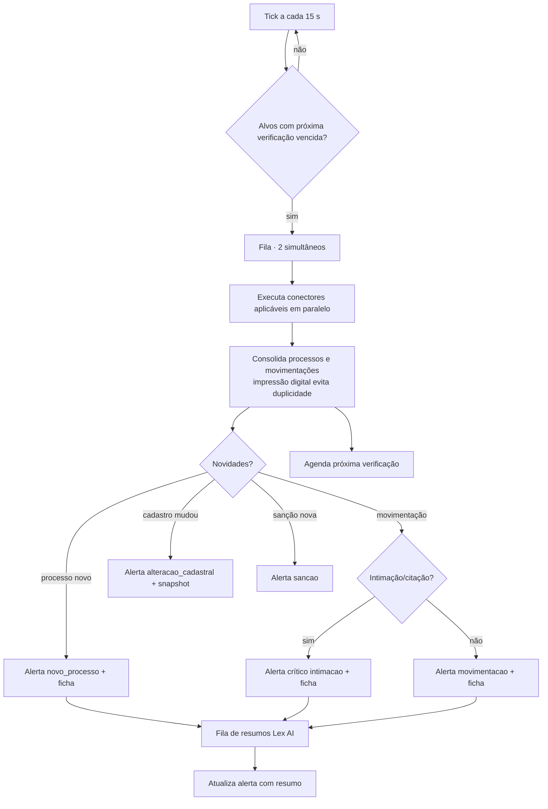
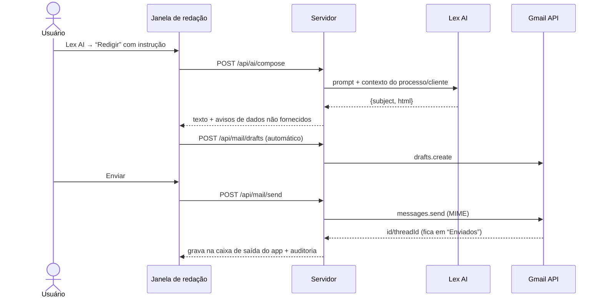
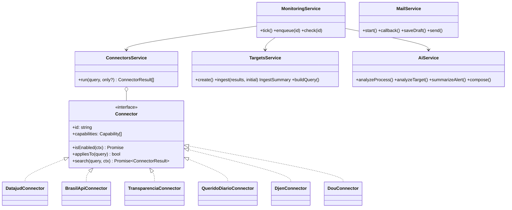

# Arquitetura

## Visão geral

```mermaid
flowchart LR
  subgraph Desktop["App desktop (Electron)"]
    SPL[Splash] --> WIN[Janela principal]
    MAIN[Processo principal<br/>backup · restauração · atualização · desinstalação]
  end
  subgraph Server["Servidor local (NestJS · Node embutido)"]
    API[API REST /api] --> AUTH[Auth JWT + 2FA + perfis]
    API --> TGT[Pessoas/Empresas]
    API --> CLI[Clientes]
    API --> MAIL[E-mail Gmail]
    API --> AI[Lex AI]
    API --> REP[Relatórios]
    MON[Fila de monitoramento<br/>intervalo 15 s] --> CON[Conectores]
    MON --> ING[Consolidação e detecção de mudanças]
    ING --> AIQ[Fila de resumos IA]
    UI[Interface Next.js estática]
  end
  DB[(SQLite<br/>~/.lex-detetive/lex.db<br/>AES-256)]
  WIN -- http://127.0.0.1:3333 --> API
  WIN --> UI
  MAIN -- inicia/encerra --> Server
  Server --> DB
  CON --> DJ[CNJ DataJud]
  CON --> BR[BrasilAPI · Receita CNPJ]
  CON --> PT[Portal da Transparência]
  CON --> QD[Querido Diário]
  AI --> OL[Ollama / LM Studio]
  AI --> CL[OpenAI · Gemini · Claude · Grok · OpenRouter]
  MAIL --> GM[Gmail API OAuth]
```



| Camada | Tecnologia | Observação |
|---|---|---|
| Interface | Next.js 16 (export estático), React 19, TypeScript, Tailwind 4, componentes no padrão shadcn, Recharts | Mesma interface no navegador, no desktop e futuramente no Capacitor |
| Servidor | NestJS 11, Node 20+ | Monólito modular (módulos = pastas em `apps/api/src`) |
| Banco | Prisma 5 + SQLite (local) | Migrações SQL versionadas aplicadas na inicialização (`src/migrate.ts`) |
| Fila | Fila em processo (`MonitoringService`) | Interface `enqueue/check` pronta para BullMQ + Redis no SaaS |
| IA | Ollama, LM Studio, OpenAI, Gemini, Claude (SDK oficial), Grok, OpenRouter | Fallback por regras quando não há IA |
| Desktop | Electron 44 + electron-builder | NSIS (Windows), pkg/dmg (macOS), AppImage/deb (Linux). Tauri foi avaliado; Electron foi escolhido por embutir o Node que o servidor precisa |

## Modelo de dados (ER)

```mermaid
erDiagram
  User ||--o{ AuditLog : registra
  Target ||--o{ Process : possui
  Target ||--o{ Alert : gera
  Target ||--o{ Snapshot : historico
  Target ||--o{ Analysis : parecer
  Process ||--o{ Movement : movimentacoes
  Process ||--o{ Analysis : analise
  Process ||--o{ ClientProcess : vinculo
  Client ||--o{ ClientProcess : vinculo
  Client |o--o| Target : monitoramento
  User ||--o| MailAccount : gmail
  User ||--o{ EmailMessage : caixa_de_saida

  User { string id PK; string email UK; string role; string totpSecret "cifrado" }
  Target { string id PK; string kind "PF|PJ"; string name; string documentEnc "cifrado"; string documentHash "indice cego"; bool monitored; int intervalMinutes; string registry "JSON" }
  Process { string id PK; string number "CNJ"; string court; string organ "vara"; string status; float value; string parties "JSON"; string source }
  Movement { string id PK; datetime date; string description; string fingerprint UK }
  Alert { string id PK; string type; string severity; string data "ficha + resumo IA" }
  Snapshot { string id PK; string source; string data; string changes }
  Client { string id PK; string kind; string name; string documentEnc; string email; string phone; string zip; string city }
  ClientProcess { string id PK; string role "autor|réu|..." }
  EmailMessage { string id PK; string folder; string to; string subject; string gmailMessageId }
  Setting { string key PK; string value; bool secret }
```

## Fluxo do monitoramento



## Sequência: envio de e-mail com IA



## Classes principais (UML)



## Como adicionar um conector
1. Crie `apps/api/src/connectors/minha-fonte.connector.ts` implementando `Connector`.
2. Registre em `ConnectorsService.connectors` e no catálogo (`catalog.ts`).
3. Retorne `processes`, `registry` (dados cadastrais, comparados entre verificações) e/ou `records` (sanções, publicações).
A consolidação, os alertas, os relatórios e a IA passam a usar a nova fonte automaticamente.

## Evolução para SaaS
- Trocar `provider` do Prisma para `postgresql` e acrescentar `organizationId` (multiempresa) em todas as tabelas.
- Substituir a fila em processo por **BullMQ + Redis** (mesma interface `enqueue/check`), com workers separados.
- Chave mestra por organização em KMS; backups gerenciados.
- `docker-compose.yml` já traz o perfil `saas` (Postgres, Redis, Ollama).
- Mobile: Capacitor empacotando a mesma interface apontando para o servidor SaaS.
